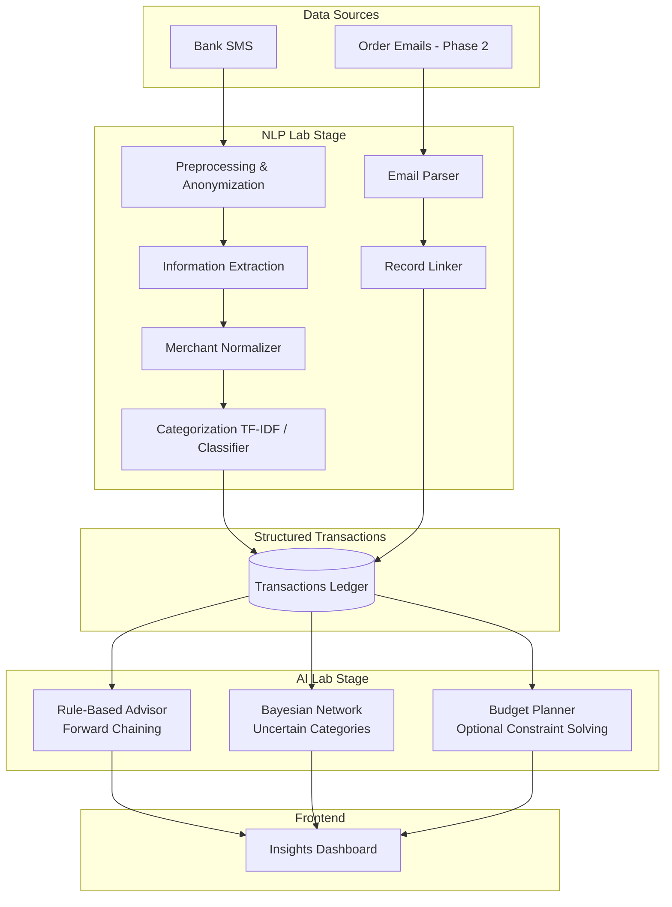

# Casho — Know Where Every Rupee Went

### Smart Expense Tracker: Automatic Spending Categorization from Bank SMS and Emails

[](https://python.org)
[](https://fastapi.tiangolo.com)
[](https://react.dev)
[](https://scikit-learn.org)
[](#-lab-mapping)
[](#-lab-mapping)

---

## 🧾 Executive Summary

UPI and card payments are everywhere, but the messages they generate only say *where* money went, not *what* it was spent on. A message like *"Payment successful to Amazon"* could mean groceries, electronics, books, or anything else.

**Casho** is a full-stack academic project that reads bank SMS and order emails, extracts transaction details, links the two sources, and categorizes every expense so users can see where their money actually goes.

Built as a combined mini-project for the **Natural Language Processing Lab** and the **Artificial Intelligence Lab** (*T.Y. B.Tech CSE AI & ML, PCCOE Pune*).

> **Status:** Work in progress. Features are delivered in phases (see [Roadmap](#️-roadmap)).

---

## 🌟 Key Capabilities

### 1. NLP Pipeline for Bank SMS (NLP Lab)
- **Preprocessing and anonymization**: Removes account numbers, phone numbers, and personal details; cleans and tokenizes noisy SMS text.
- **Information extraction**: Pulls out amount, debit/credit type, merchant, date, and payment mode, using a regex baseline compared against a trained sequence tagger.
- **Merchant normalization**: Turns messy strings such as `SWIGGY*BLR 4821` into a canonical merchant name using edit distance, character n-grams, and a merchant dictionary.
- **Categorization**: TF-IDF features with a classifier, compared against an embedding-based approach.

### 2. Email Enrichment (Phase 2)
- **Order and receipt parsing**: Extracts order ID, item names, amount, and date from order-confirmation emails.
- **Record linking**: Matches each SMS transaction to its email using amount, date window, and normalized merchant.
- **Item-level categorization**: When an email is linked, the category comes from what was actually bought (for example, a USB-C cable means *Electronics*), resolving the *"Payment to Amazon"* ambiguity.

### 3. AI Reasoning Layer (AI Lab)
- **Forward-chaining advisor**: A rule-based inference engine that derives facts such as `overspent(Food)`, `subscription(Netflix)`, and `unusual_spend(txn)`, producing plain-language advice. Every rule that fires is logged, making the reasoning trace fully visible and explainable.
- **Bayesian network**: When no email is available, estimates the most likely category of an ambiguous transaction from contextual evidence (time of day, day type, amount range, payment mode, merchant).
- **Budget planner (optional)**: Allocates a monthly budget under constraints using backtracking and hill climbing.

### 4. Insights Dashboard
- Monthly totals and category breakdown
- Recurring payments and subscriptions
- Unusual spends & anomalies
- Traceable advice generated by the rule engine

---

## 🏷️ Spending Categories

| Category | Examples |
|---|---|
| **Food** | Swiggy, Zomato, cafes |
| **Shopping** | Amazon, Flipkart, clothing |
| **Travel** | Uber, Ola, rail, fuel |
| **Bills & Subscriptions** | Electricity, mobile recharge, OTT platforms |
| **Other** | Anything unmatched |

---

## 🏗️ System Architecture



- **NLP stage**: Turns unstructured messages into clean, structured transactions.
- **AI stage**: Reasons over those transactions to explain, advise, and handle uncertainty.

---

## 📂 Repository Organization

```text
Casho/
├── backend/
│   ├── app/
│   │   ├── main.py                    # FastAPI app and CORS setup
│   │   ├── config.py                  # Categories, thresholds, paths
│   │   ├── schemas.py                 # Request/response models
│   │   ├── api/
│   │   │   └── routes.py              # /parse, /transactions, /summary, /advice
│   │   ├── nlp/
│   │   │   ├── preprocess.py          # Anonymize, clean, tokenize
│   │   │   ├── extractor.py           # Amount, merchant, date, type extraction
│   │   │   ├── merchant_normalizer.py # Edit distance, n-grams, merchant dictionary
│   │   │   ├── categorizer.py         # TF-IDF + classifier
│   │   │   ├── email_parser.py        # Order email parsing (Phase 2)
│   │   │   └── linker.py              # SMS-to-email record linking (Phase 2)
│   │   ├── ai/
│   │   │   ├── rules.py               # Forward-chaining rule definitions
│   │   │   ├── forward_chaining.py    # Inference engine with rule trace
│   │   │   └── bayes_net.py           # Bayesian network for ambiguous categories
│   │   ├── services/
│   │   │   └── pipeline.py            # Orchestrates SMS -> NLP -> AI
│   │   └── db/                        # SQLite connection and models
│   ├── data/
│   │   ├── sample/                    # Synthetic SMS and sample emails (safe to commit)
│   │   ├── labeled/                   # Anonymized labeled set (NOT committed)
│   │   └── merchants.json             # Canonical merchant dictionary
│   ├── evaluation/                    # Evaluation scripts and result tables
│   ├── tests/                         # Pytest test suite
│   └── requirements.txt               # Python dependencies
├── frontend/
│   ├── src/
│   │   ├── components/                # Charts, transaction table, cards
│   │   ├── pages/                     # Dashboard, Upload, Transactions, Insights, About
│   │   ├── lib/
│   │   │   ├── api.ts                 # REST client
│   │   │   └── types.ts               # TypeScript interfaces
│   │   ├── App.tsx                    # Routing
│   │   └── main.tsx                   # Entry point
│   ├── package.json
│   └── vite.config.ts
├── docs/
│   ├── PRD.md                         # Product requirements
│   ├── DESIGN.md                      # Visual design and UX rules
│   ├── ARCHITECTURE.md                # Technical architecture
│   ├── DATABASE.md                    # Data model
│   ├── API.md                         # API specification
│   ├── IMPLEMENTATION_PLAN.md         # Phase-wise build plan
│   ├── DEMO_GUIDE.md                  # Presentation script and viva Q&A
│   └── journals/
│       ├── nlp_lab/                   # NLP lab journal write-ups
│       └── ai_lab/                    # AI lab journal write-ups
├── notebooks/                         # Data exploration
├── AGENTS.md                          # Rules for the coding agent
├── .env.example                       # Environment variable template
├── .gitignore
└── README.md
```

---

## 🚀 Getting Started

### Prerequisites
- **Python 3.10** or newer
- **Node.js 20** or newer

### 1. Backend Setup and Launch
```bash
cd backend
python -m pip install -r requirements.txt
uvicorn app.main:app --reload --host 0.0.0.0 --port 8000
```
- **Interactive API docs:** [http://localhost:8000/docs](http://localhost:8000/docs)
- **Health check:** `http://localhost:8000/`

### 2. Frontend Launch
```bash
cd frontend
npm install
npm run dev
```
Open [http://localhost:5173](http://localhost:5173) in your browser.

### 3. Environment Configuration
```bash
cp .env.example .env
```
Edit `.env` for local settings. Never commit real credentials or personal data.

### 4. Running Tests and Evaluation
```bash
# Backend test suite
cd backend
python -m pytest tests/

# Evaluation scripts (extraction and categorization)
python evaluation/eval_extraction.py
python evaluation/eval_categorizer.py

# Frontend production build check
cd frontend
npm run build
```

---

## 📊 Evaluation Plan

| Component | Metric | Comparison |
|---|---|---|
| **Field extraction** | Precision, recall, F1 per field | Regex baseline vs. sequence tagger |
| **Unseen-bank generalization** | F1 on a bank not seen in training | Regex vs. tagger |
| **Merchant normalization** | Matching accuracy | Edit distance alone vs. edit distance + n-gram |
| **Categorization** | Per-class F1, macro F1 | TF-IDF baseline vs. embeddings |
| **SMS-to-email linking** | Linking accuracy | Amount + date vs. amount + date + merchant |
| **Category accuracy by input** | Accuracy | SMS only vs. email only vs. SMS + email |
| **Ambiguous merchants** | Accuracy | Classifier vs. Bayesian network |

### Results Table
*To be filled in as experiments complete.*

| Experiment | Result |
|---|---|
| **Extraction F1 (regex)** | TBD |
| **Extraction F1 (tagger)** | TBD |
| **Categorization macro F1** | TBD |
| **SMS + email vs. SMS only** | TBD |

---

## 🔒 Data and Privacy

- **Sensitive Data Handling**: Transaction messages and emails contain sensitive personal information.
- **Anonymization**: All real data is anonymized before use (account numbers, names, phone numbers, and UPI IDs are replaced with placeholders).
- **Local Execution**: Processing runs locally. No message content is sent to third-party services.
- **Strict Git Exclusion**: `backend/data/labeled/` and any real SMS or email files are excluded by `.gitignore`. Only synthetic samples are committed.

---

## 🗺️ Roadmap

- [ ] **Phase 1 — Core NLP pipeline:** SMS preprocessing, extraction, merchant normalization, categorization, basic summary
- [ ] **Phase 2 — Enrichment and AI:** email parsing and linking, forward-chaining advisor, Bayesian network
- [ ] **Phase 3 — Polish:** dashboard, demo flow, documentation
- [ ] *(Optional)* Budget planner with constraint satisfaction and hill climbing

---

## 🎓 Lab Mapping

| Lab | Components |
|---|---|
| **NLP Lab** | Preprocessing, tokenization, TF-IDF, n-gram models, information extraction, text classification, NLP pipeline mini-project |
| **AI Lab** | Forward chaining (knowledge representation and reasoning), Bayesian network (uncertain reasoning), optional constraint satisfaction and hill climbing |

---

## 👥 Team

- **[Your Name]** — [role]
- **[Teammate Name]** — [role]
- **Guide:** [Faculty Name], Department of Computer Science & Engineering (AI & ML), PCCOE, Pune

---

## ⚖️ Limitations and Disclosure

Casho is built as an academic project. Categories are predictions based on message content and may be wrong, especially for ambiguous merchants or when no matching email exists. SMS and email formats vary across banks and merchants and can change over time. The system provides spending insights and is not financial advice.
